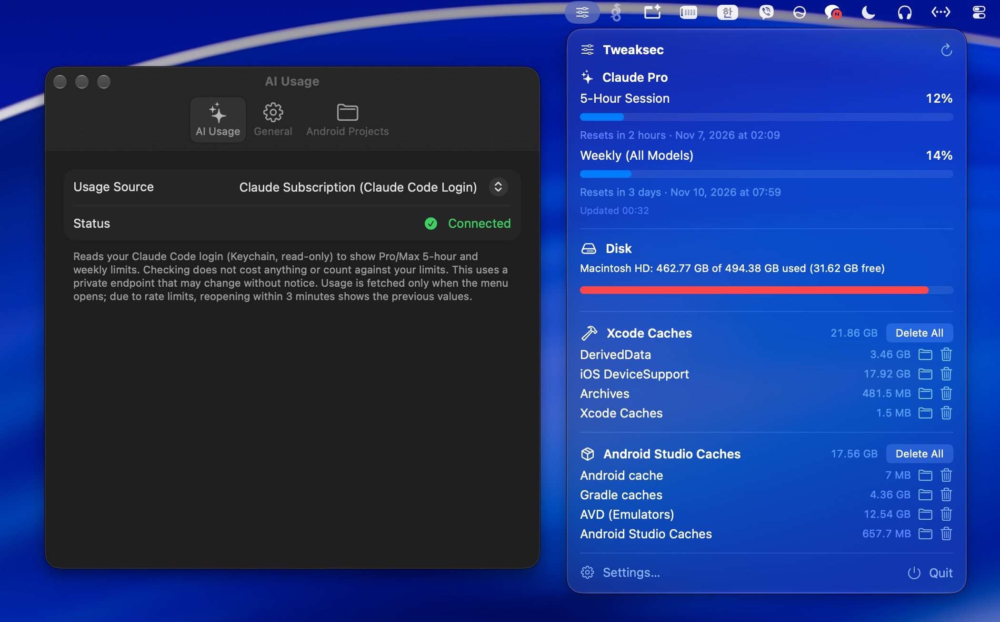

# Tweaksec

A native macOS menu bar app for developers. It shows your AI usage limits and disk space, and frees up space by cleaning Xcode and Android Studio caches.

Built with SwiftUI and Apple frameworks only, with no third-party dependencies.



*Tweaksec running.*

## Features

**AI usage.** Choose one source at a time in Settings → AI Usage:

| Source                        | Shows                            | Authentication    | API     |
| ----------------------------- | -------------------------------- | ----------------- | ------- |
| Claude Subscription (default) | Pro/Max 5-hour and weekly limits | Claude Code login | Private |
| Anthropic Admin API           | Organization tokens this month   | Admin API key     | Public  |
| OpenAI Admin API              | Organization tokens this month   | Admin key         | Public  |
| DeepSeek API Balance          | Prepaid balance                  | API key           | Public  |
| ChatGPT Subscription          | 5-hour and weekly limits         | Codex CLI login   | Private |
| Gemini                        | Per-model daily request quotas   | Gemini CLI login  | Private |

**Disk usage.** Shows a progress bar for the startup disk or another mounted volume.

**Cache cleanup.** Shows the size of each Xcode and Android Studio cache, opens it in Finder, or deletes it. Deleting asks for confirmation first and moves items to the Trash unless you enable permanent deletion.

**General.** Opens the menu with a global shortcut (default: `Control`+`Shift`+`T`, configurable) and can launch at login.

## Requirements

- macOS 14 or later
- Xcode 16 or later (Swift 6)
- [XcodeGen](https://github.com/yonaskolb/XcodeGen): `brew install xcodegen`

## Getting started

`project.yml` is the source of truth. `Tweaksec.xcodeproj` is generated and not tracked in git, so run XcodeGen after cloning and whenever you add files or change `project.yml`.

```sh
git clone https://github.com/Bluekeisoftcode/tweaksec-mac.git
cd tweaksec-mac
xcodegen generate
```

### Set up signing

`project.yml` contains the maintainers' Apple team ID and bundle identifiers. To run the app from Xcode, change these to your own and run `xcodegen generate` again:

- `DEVELOPMENT_TEAM`
- `bundleIdPrefix`
- `PRODUCT_BUNDLE_IDENTIFIER` (both targets)

To build from the command line without an Apple Developer account, use ad-hoc signing:

```sh
xcodebuild -project Tweaksec.xcodeproj -scheme Tweaksec -configuration Release \
  -destination 'generic/platform=macOS' -derivedDataPath build \
  DEVELOPMENT_TEAM= CODE_SIGN_IDENTITY=- CODE_SIGN_STYLE=Manual build
```

The app is written to `build/Build/Products/Release/Tweaksec.app`.

### Run the tests

```sh
xcodebuild -project Tweaksec.xcodeproj -scheme Tweaksec -destination 'platform=macOS' \
  DEVELOPMENT_TEAM= CODE_SIGN_IDENTITY=- CODE_SIGN_STYLE=Manual test
```

## Configuring usage sources

### CLI login sources

These sources reuse an existing CLI login. Tweaksec only reads the token and never refreshes it, because rotating a refresh token would sign the CLI out. If a token expires, run the CLI again to refresh it.

| Source               | Log in with                          | Token location                                                                |
| -------------------- | ------------------------------------ | ----------------------------------------------------------------------------- |
| Claude Subscription  | `claude`, then `/login`          | Keychain item `Claude Code-credentials`, or `~/.claude/.credentials.json` |
| ChatGPT Subscription | `codex login`                      | `~/.codex/auth.json`                                                        |
| Gemini               | `gemini`, then "Login with Google" | `~/.gemini/oauth_creds.json`                                                |

- Reading the Claude login may trigger a Keychain prompt in the sandboxed app.
- Codex and Gemini need home folder access, which you grant from the menu.
- Codex logins stored in the OS keyring are not supported.

### API key sources

Select the source in Settings → AI Usage, then paste a key. Keys are stored in the Keychain.

| Source               | Key                | Get one from                                                                   |
| -------------------- | ------------------ | ------------------------------------------------------------------------------ |
| Anthropic Admin API  | `sk-ant-admin…` | [Anthropic Console](https://console.anthropic.com/settings/admin-keys)          |
| OpenAI Admin API     | `sk-admin-…`    | [OpenAI Platform](https://platform.openai.com/settings/organization/admin-keys) |
| DeepSeek API Balance | `sk-…`          | [DeepSeek Platform](https://platform.deepseek.com/api_keys)                     |

Regular Anthropic API keys can't read usage. The two Admin API sources also accept an optional monthly token limit.

### Refresh behavior

Usage is fetched only when the menu opens, never in the background. Reopening the menu within the minimum interval shows the previous values.

| Sources                                           | Minimum interval |
| ------------------------------------------------- | ---------------- |
| Claude Subscription, ChatGPT Subscription, Gemini | 3 minutes        |
| Anthropic Admin API, OpenAI Admin API, DeepSeek   | 1 minute         |

## Private API notice

The Claude Subscription, ChatGPT Subscription, and Gemini sources call undocumented endpoints used by the vendors' own CLIs. These endpoints can change or stop working without notice, and these sources reuse tokens issued to those CLIs. Check that this use fits your agreement with each vendor before relying on them.

Tweaksec is an independent project and is not affiliated with or endorsed by Anthropic, OpenAI, Google, or DeepSeek.

## Privacy and security

- Tweaksec has no analytics or backend of its own. Network requests go only to the API of the selected source.
- Credentials are sent only to the vendor they belong to.
- API keys are stored in the Keychain. CLI tokens are read when needed and are not written anywhere by Tweaksec.
- The app runs in App Sandbox with the hardened runtime enabled. Cache cleanup requires granting home folder access once, which is kept as a security-scoped bookmark.

## Cleanup targets

| Group   | Target                 | Path                                                                       |
| ------- | ---------------------- | -------------------------------------------------------------------------- |
| Xcode   | DerivedData            | `~/Library/Developer/Xcode/DerivedData/*`                                |
| Xcode   | iOS DeviceSupport ⚠️ | `~/Library/Developer/Xcode/iOS DeviceSupport/*`                          |
| Xcode   | Archives ⚠️          | `~/Library/Developer/Xcode/Archives/*`                                   |
| Xcode   | Xcode Caches           | `~/Library/Caches/com.apple.dt.Xcode/*`                                  |
| Android | Android cache          | `~/.android/cache/*`                                                     |
| Android | Gradle caches          | `~/.gradle/caches/*`                                                     |
| Android | AVD ⚠️               | `~/.android/avd/*`                                                       |
| Android | Android Studio Caches  | `~/Library/Caches/Google/AndroidStudio*`                                 |
| Android | Project builds         | `build/` at the root and one level below, for projects added in Settings |

⚠️ These targets show an extra warning, because deleting them removes more than regenerable build output:

- **iOS DeviceSupport:** symbol files are downloaded again when a device is connected.
- **Archives:** distribution archives (`.xcarchive`) and dSYMs are deleted.
- **AVD:** all emulators you created are deleted.

Target folders are kept; only their contents are deleted. As a safeguard, Tweaksec only deletes items at least two levels below your home folder. A project folder can be added only if it meets the same depth rule and contains `settings.gradle` or `build.gradle(.kts)`.

## Project structure

```
Tweaksec/
  App/        Entry point (MenuBarExtra and Settings scenes)
  Views/      Menu sections and the settings window
  Stores/     @Observable state: settings, usage, disk, cache
  Services/   Disk, cache, Keychain, hotkey, and notification services
    Usage/    UsageProvider protocol, providers, and CLI credential readers
  Models/     Value types such as CacheTarget and UsageSnapshot
  Support/    Formatting, home folder access, menu panel helpers
  Resources/  Assets, Info.plist, entitlements, privacy manifest
TweaksecTests/
project.yml   XcodeGen project definition
scripts/      Release build, App Store, and icon scripts
```

## Extending Tweaksec

### Add a usage provider

1. Create a type in `Tweaksec/Services/Usage/` that conforms to `UsageProvider`:
   ```swift
   protocol UsageProvider: Sendable {
       var minimumRefreshInterval: TimeInterval { get }
       func fetchUsage() async throws -> UsageSnapshot
   }
   ```
2. Add a case to `UsageSource` and fill in its `title`, `menuTitle`, and `keychainAccount`.
3. Create the provider in `UsageStore.makeProvider()`.
4. Add the `footer` and `keySetup` values in `SettingsView.swift`.
5. Add tests in `TweaksecTests/`. Existing provider tests are a good template.

Use `UsageError.check(_:data:)` to map HTTP responses to errors. The compiler flags every `switch` that needs the new case.

### Add a cleanup target

Add a `CacheTarget` to `CacheTarget.defaults(home:)` in `Tweaksec/Models/CacheTarget.swift`. Set `warning` if deleting it removes anything that can't be regenerated.

## Release builds

These scripts use your signing configuration, so complete [Set up signing](#set-up-signing) first.

```sh
# dist/Tweaksec.app and dist/Tweaksec.zip
SIGN_IDENTITY="Developer ID Application: …" ./scripts/build.sh

# Mac App Store: dist/appstore/ (add UPLOAD=1 to upload to App Store Connect)
TEAM_ID=<your-team-id> ./scripts/appstore.sh
```

Without `SIGN_IDENTITY`, `build.sh` signs ad-hoc. Distributing outside the App Store also requires notarization, which the scripts don't perform.

To regenerate the app icon, run `swift scripts/make-icon.swift`.

## Contributing

Issues and pull requests are welcome. Before opening a pull request, run the tests and don't commit generated projects, credentials, or signing files.

## About

Tweaksec is built and maintained by [BLUEKEI SOFT](https://www.bluekeisoft.net).

## License

[MIT](LICENSE) © 2026 BLUEKEI SOFT
